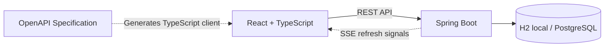

# PantryPal

Keep track of what you have, what needs using soon, and what to buy next.

PantryPal brings inventory, expiry reminders and shopping lists together. Add your essentials, record stock changes, and review shortages before your next shop. When a purchase is complete, items linked to your inventory can be restocked without applying the same purchase twice.

This is an actively developed portfolio project. The current deployed environment is **staging on `GS-134`**; production launch is deferred. The application is free to use at this stage, with no subscription implemented.

## What you can do

- **Manage inventory:** record categories, quantities, preset or custom units, minimum thresholds, optional expiry dates and notes.
- **Adjust stock:** consume or restock an amount, with retry-safe updates and a time-limited Undo when no intervening change prevents it.
- **See what needs attention:** view expired, out-of-stock, expiring-soon and low-stock items on the dashboard and in the notification panel.
- **Plan a shop:** review shortage suggestions, adjust quantities, or create a shopping list yourself. Rename lists and edit item quantities, units and notes.
- **Complete a purchase:** mark shopping-list items as purchased, then complete the purchase to restock linked inventory items once. Repeating completion does not restock them again, and unlinked items do not automatically create inventory records.
- **Sign in with email:** use one-time verification codes and server-backed sessions. Inventory and lists are scoped to the signed-in account.
- **Manage your account:** sign out or delete your account after recent email verification.
- **Send feedback:** use the contact form when the environment's support mailbox and mail transport are configured.

Expiry and stock conditions can overlap. The primary alert follows this order: **Expired → Out of Stock → Expiring Soon → Low Stock**. Other applicable conditions remain available; expiry-only reminders do not create shopping suggestions. See the [architecture and workflow guide](docs/ARCHITECTURE.md) for how these pieces fit together.

## Current scope

| Available now | Not available yet |
| --- | --- |
| Browser-based inventory and shopping workflows | Native mobile apps |
| In-app stock and expiry alerts | Scheduled expiry emails; the app labels these as planned |
| Account-scoped data and independent sign-in sessions | Shared households, invitations and roles |
| Preset and custom unit entry | Barcode or receipt scanning |
| Illustrative price-comparison screen | Live retailer prices, grocery ordering or payments |
| Active-database account deletion | Instant erasure of delivered mail, browser copies or backups |

Recipe suggestions, meal planning and other extensions remain backlog work. Future features are not required to explore the current application locally.

## How it is built

| Part | Technology and role |
| --- | --- |
| Frontend | React, TypeScript and Vite; TanStack Query caches API responses |
| Backend | Java / Spring Boot, Spring Security and parameterized JDBC |
| Database | PostgreSQL in staging and the optional local Docker setup; file-backed H2 for the default local setup |
| Schema changes | Versioned Flyway migrations |
| API contracts | OpenAPI with Orval-generated TypeScript clients and Zod schemas |
| Authentication | Email OTP, database-backed sessions and CSRF protection |
| Refresh signals | Server-Sent Events (SSE) and query refetching |
| Email | SMTP; Mailpit for local development, provider configuration for staging |
| Deployment | Docker on Render, with separate staging and proposed production Blueprints |

Spring Boot serves the built frontend and `/api` from one service. The backend owns validation and committed stock; the browser cache refreshes after successful changes. SSE carries refresh signals rather than a durable notification history. OpenAPI generates client contracts, not the Spring implementation.

### Architecture at a glance



Read the [architecture](docs/ARCHITECTURE.md) for diagrams covering the application, stock adjustments and shopping workflow.

## Branches and environments

| Environment | Branch / configuration | Status |
| --- | --- | --- |
| Local development | Your working branch | H2, PostgreSQL or a browser-only mock mode |
| Render staging | `GS-134` · [render.yaml](render.yaml) | Current integration and browser-verification environment |
| Proposed production | `main` · [render.production.yaml](render.production.yaml) | Preparation only; provisioning and cutover are deferred |

Staging is a test environment, not a place to keep important or irreplaceable data. Its free hosting can sleep and the database has lifecycle limits. Running the Spring `production` profile on staging enables deployment settings; it does not mean the production launch is complete.

The production Blueprint and [production plan](docs/GS-141-PRODUCTION-PLAN.md) describe a separate future environment. Their presence does not mean those resources, backups or the production domain are live.

## Run locally

Use **Node.js 24**, **pnpm 10.26.1** and **JDK 17+**. The repository includes the Maven wrapper, so a global Maven install is not required. Initial dependency and wrapper downloads require network access.

### Option 1: Spring Boot with local H2

Start Mailpit with SMTP listening on `127.0.0.1:1025` and its inbox on `127.0.0.1:8025`. For example, with an installed Mailpit executable:

```sh
mailpit --listen 127.0.0.1:8025 --smtp 127.0.0.1:1025
```

In another terminal, from the repository root:

```sh
npx pnpm@10.26.1 install
npx pnpm@10.26.1 start
```

Open [localhost:8080](http://localhost:8080). Create an account, then read its verification code in [Mailpit](http://localhost:8025). Mailpit captures messages locally; it does not deliver them to a real inbox.

The app starts with an empty pantry. H2 data persists in `backend/data/pantrypal.mv.db`, which is ignored by Git. Stop with Ctrl+C; rerun the start command after frontend changes.

Set `JAVA_HOME` to your installed JDK if needed. The start launcher reads an optional ignored root `.env`; direct Maven launches require environment variables in the shell or IDE. See [environment setup](docs/ENVIRONMENT.md) for data-directory and PostgreSQL profile settings.

### Option 2: Docker Compose with PostgreSQL

With Docker and Compose running, from the repository root:

```sh
docker compose up --build -d
```

Open [localhost:8080](http://localhost:8080) and read email codes in [Mailpit](http://localhost:8025). Compose starts PostgreSQL, Mailpit and the app. Stop native Mailpit first if it already occupies those ports.

`docker compose down` stops the services while retaining the database volume. Rebuild after source changes. These Compose settings are for local development, not a production deployment.

### Browser-only development preview

For UI exploration without Java, a database or email delivery:

```sh
npx pnpm@10.26.1 install
npx pnpm@10.26.1 dev:mock
```

Open [localhost:5173](http://localhost:5173). This explicit local mode uses sample data in browser storage and preview authentication, not server-backed accounts. It must not be confused with staging or production authentication. Reset demo data restores its local samples.

To seed an already-running local full-stack app instead, use `npx pnpm@10.26.1 seed:demo` and follow the Mailpit verification prompt. This is a separate authenticated API operation, not an import of browser storage. See [environment setup](docs/ENVIRONMENT.md).

## Testing and verification

Verification combines executable tests, hands-on browser checks and AI-assisted review. Each provides different evidence; an agent's summary or a passing build does not establish that every flow works.

| Method | What it checks | Limits |
| --- | --- | --- |
| Backend automated tests | Validation, account boundaries, authentication, stock transactions, purchase retry safety and notification lifecycle | Default H2 results do not prove PostgreSQL behavior |
| Frontend and schema tests | Forms, mock handlers, route/session states, regression scenarios and generated-schema validation | DOM tests do not establish real browser layout, contrast or mobile reachability |
| Manual staging checks | Real OTP delivery, browser behavior, cookies, end-to-end workflows and persistence after a service restart | Results apply to the tested revision, environment and browser |
| AI-assisted testing and review | Coding-agent test execution and investigation, plus CodeRabbit PR review | Agents can miss defects; review findings need validation, and reported results must identify what actually ran |

Staging checks have been carried out during development by the project owner, alongside agent-assisted verification. Record the deployed revision, browser/viewport, procedure, result and remaining gaps in the relevant issue or PR. Keep credentials, session values, OTPs and personal message contents out of evidence.

From the repository root:

```sh
npx pnpm@10.26.1 --filter @workspace/grocery-app test
npx pnpm@10.26.1 --filter @workspace/api-zod test
npx pnpm@10.26.1 build
```

The root build includes typechecking. From `backend`:

```sh
sh ./mvnw test
```

On Windows, use `.\mvnw.cmd test`. Run PostgreSQL-specific migration, isolation, concurrency and restart checks against an isolated test database. Do not point destructive tests at staging, production or your normal local database.

No fixed test count is promised here: counts and outcomes belong with the revision that was actually checked.

## Data and operational boundaries

- Keep deployment credentials in protected configuration and local secrets in ignored files.
- Account deletion removes owned records from the active database and revokes sessions. Email-provider, mailbox and backup copies require separate handling.
- Production backup retention and restore reconciliation remain release requirements; a local rehearsal is not production backup evidence.
- Household sharing is not implemented merely because the interface says “My household.”
- The active backend is `backend/`. The old Express service in `artifacts/api-server/` and Drizzle package in `lib/db/` are historical and excluded from the active workspace. **`lib/api-zod/` is active** and contains generated validation schemas.

Use a fresh Flyway-managed database. Former Drizzle databases are not automatically imported or baselined.

## Further reading

For a guided overview of the technical documentation, see the [Documentation Index](docs/README.md).

- [Environment and local development](docs/ENVIRONMENT.md)
- [Architecture and workflow diagrams](docs/ARCHITECTURE.md)
- [Email OTP and session flow](docs/EMAIL-OTP-AUTH-FLOW.md)
- [Account deletion and recovery boundaries](docs/GS-137-DATA-DELETION.md)
- [Backup and restore runbook](docs/GS-136-BACKUP-RESTORE.md)
- [Production preparation plan](docs/GS-141-PRODUCTION-PLAN.md)
- [API specification](lib/api-spec/openapi.yaml)
- [GitHub Wiki](https://github.com/chankiahuja/pantry-pal/wiki)
- [Open issues](https://github.com/chankiahuja/pantry-pal/issues)

Contributor guidance starts in [AGENTS.md](AGENTS.md). Agent-specific entry points also include [CLAUDE.md](CLAUDE.md) and [GEMINI.md](GEMINI.md).
