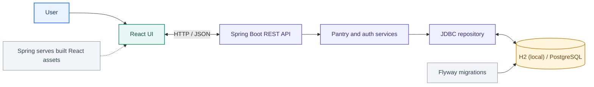
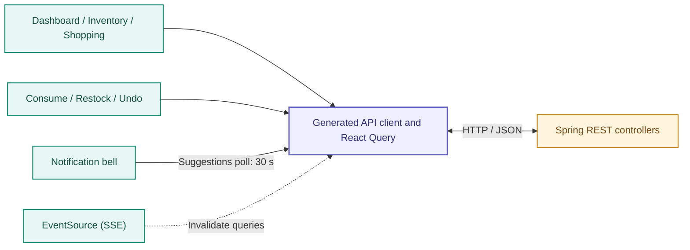
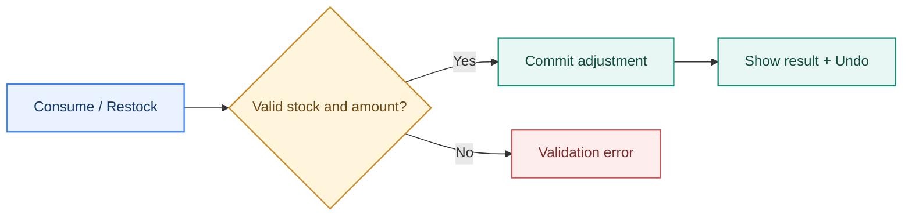
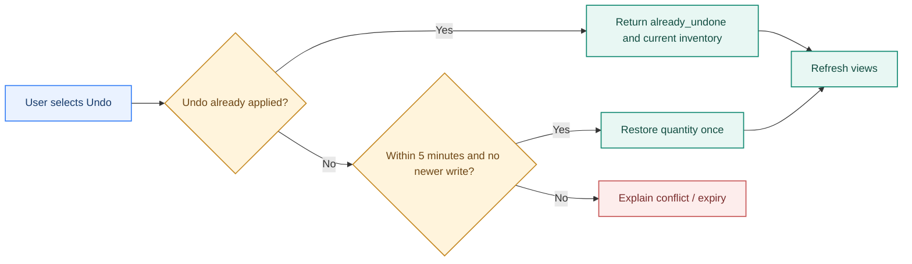
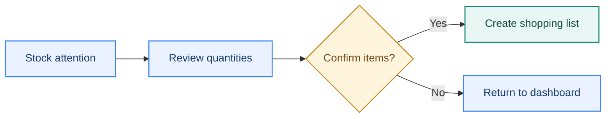
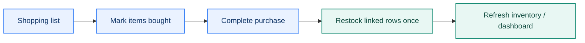
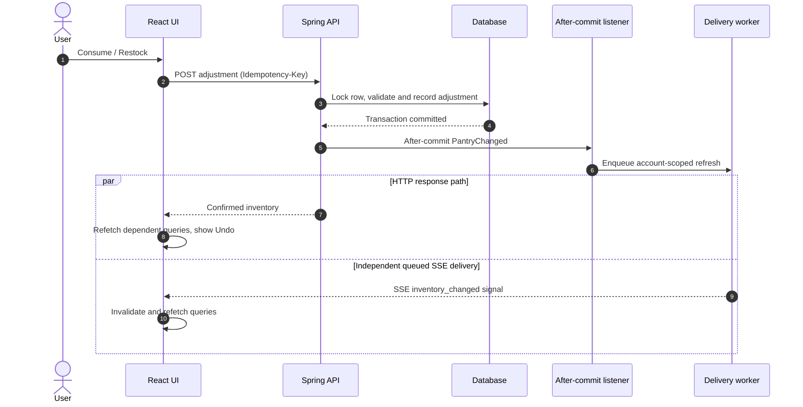
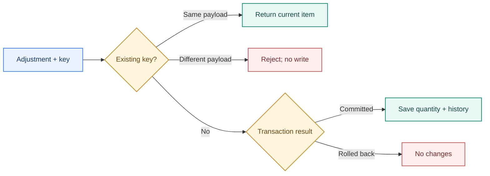

# Architecture — detailed technical reference

> This reference preserves the full architecture documentation and all nine diagrams from the GS-158 architecture document prior to the readability refactor. For a faster introduction, start with [Architecture at a glance](ARCHITECTURE.md#architecture-at-a-glance).
>
> **Reference scope:** Detailed behavior, edge cases, flows and operational constraints. The concise overview is [ARCHITECTURE.md](ARCHITECTURE.md).

---

# Architecture

Account deletion is documented in the [data inventory and deletion protocol](GS-137-DATA-DELETION.md). The authenticated account operation requires server-recorded email verification within five minutes, deletes active owned records transactionally, and revokes all sessions. Pantry writes acquire an account lock so a concurrent write cannot survive deletion. After-commit cleanup closes notification streams; API requests also reject stale sessions whose account no longer exists. Mailbox cleanup and backup restore reconciliation remain operator release gates. The privacy page is explicitly a draft pending deployment review.

## Application overview

PantryPal is a React application backed by one Spring Boot service and a relational database. Spring Boot serves both the built frontend and the API on port 8080. The diagram below shows the normal full-stack runtime.

The overview is divided into three focused views. Blue marks entry points, teal marks browser or refresh activity, purple marks application logic, and amber marks storage or decisions. Solid arrows are requests or dependencies; dashed arrows are background refresh signals.

### Request and storage path

The Spring Boot server hosts the built React app and the `/api` endpoints on port 8080. H2 is used locally unless the PostgreSQL profile is configured.

### Browser interactions

### Notifications and background checks

```mermaid
flowchart LR
    Writes["Committed pantry changes"] -.-> Listener["After-commit event listener"]
    Schedule["Stock / expiry scheduler"] --> Service["Pantry suggestions"]
    Service -->|"checkExpiry calls directly"| Broadcast["Account-scoped broadcast"]
    Listener -.->|"Queue delivery worker"| Broadcast
    Broadcast -.->|"SSE refresh signal"| Browser["Browser EventSource"]
    Browser -.-> Refresh["React Query refetch"]
    Refresh -->|"Fetch current alerts"| API["Suggestions API"]

    classDef trigger fill:#EAF2FF,stroke:#3B82F6,color:#163A6B,stroke-width:1.5px
    classDef process fill:#EEF0FF,stroke:#6661C5,color:#332E72,stroke-width:1.5px
    classDef signal fill:#E8F7F3,stroke:#138A72,color:#124D41,stroke-width:1.5px
    class Writes,Schedule trigger
    class Listener,Service,Broadcast,API process
    class Browser,Refresh signal
```

SSE sends refresh signals, not alert details. Notification delivery is best effort; normal HTTP responses and the bell's 30-second polling provide additional refresh paths. There is no message broker or durable notification inbox.

The server owns validation, authenticated sessions and committed stock. React Query caches server responses and refetches dependent views after changes. SSE carries refresh signals; the notification bell recovers its alert contents from the suggestions API. There is no message broker or durable notification inbox. The public Contact & Feedback page and signed-in quick-feedback dialog use a CSRF-protected API; submissions are validated, rate limited and sent to the environment-configured support mailbox without being persisted or logged. The address and any response-time note are environment-configured; absent details are not invented. A success response means the SMTP transport accepted the message.

OpenAPI defines the REST contract and generates the TypeScript client; it does not generate the Spring backend. Database changes use new Flyway migrations. Historical Express/Drizzle packages are outside this runtime.

React routes load on demand through dynamic imports. The session gate runs before the route loading boundary, so an unauthenticated private URL redirects before loading that page's code. A pending route shows an accessible loading status; a failed page load offers a full reload at the same URL. The query client, session gate and adjustment feedback provider stay above this boundary, preserving authentication, cached data and Undo feedback across navigation. See the [frontend bundle verification](GS-104-FRONTEND-BUNDLE.md) for measurements and loading checks.

## Pantry and shopping workflow

The inventory adjustment and shopping-list lifecycles are shown separately to avoid crossing arrows and repeated loops.

### Inventory adjustment

### Undo eligibility

Invalid adjustments keep the user in the dialog. A successful adjustment refreshes dependent views whether or not the user chooses Undo. For a first Undo, the server checks expiry and intervening writes so it cannot overwrite newer stock. An already-completed Undo returns `already_undone` and current inventory before those checks, without another write.

### Generate a shopping list

### Complete a purchase

Only out-of-stock and low-stock suggestions can generate shopping items; expiry-only reminders are excluded. Manual shopping rows without linked inventory are not automatically restocked.

Normal login/signup uses server-verified email codes and database-backed sessions; email is the only offered method by default, and browser-only mock authentication remains a preview. Household authorization remains separate work. Shopping-list generation revalidates selected items against current stock on the server. Purchase completion leaves unlinked manual shopping items out of inventory.

## Adjustment transaction and refresh sequence

The successful transaction is a sequence diagram; retry and failure outcomes are a compact decision flow.

### Successful adjustment and refresh

The after-commit listener enqueues delivery before the service transaction returns. The queued SSE delivery and HTTP response can arrive at the browser in either order. The UI refreshes from the response even if SSE is unavailable; the notification bell also polls suggestions.

### Idempotency and failure handling

The service locks the inventory row and inspects the item-scoped request key. A new valid adjustment updates quantity, revision, and history atomically; a rollback preserves stock and history.

The after-commit listener only publishes refresh signals for committed changes. Undo runs as its own transaction with row locking, expiry and revision checks.

Undo is a separate transaction using the original adjustment key. It locks the inventory row, checks expiry and revision, and commits the restored quantity and used marker together. A successful retry reports `already_undone` without applying another change. The SSE signal and HTTP response are separate refresh paths; clients must not depend on their arrival order.

## Runtime modes and implementation details

This section summarizes the runtime rules. For low-level behavior, HTTP error codes, concurrency safeguards and historical implementation notes, consult [implementation notes](ARCHITECTURE-IMPLEMENTATION-NOTES.md).

### Runtime options

| Mode | What runs | Data |
| --- | --- | --- |
| Local full stack | Spring Boot serves React and `/api`; Mailpit can capture OTP messages | File-backed H2 |
| PostgreSQL runtime / staging | Same Spring Boot application with PostgreSQL and configured SMTP | PostgreSQL |
| Vite development | React hot reload on port 5173, proxied API to Spring Boot on 8080 | Backend database |
| Browser demo (`dev:mock`) | React with mocked auth and local data; no backend session | Browser localStorage |

### Important behavior

| Area | Essential rule |
| --- | --- |
| Authentication | Email OTP, server-backed sessions, account-scoped APIs and CSRF protection |
| Persistence | Flyway migrations; backend validates all writes and owns transactions |
| Notifications | Committed changes trigger account-scoped SSE refresh signals; delivery is best effort, with HTTP/polling fallback |
| Stock and expiry | UTC-based alert rules; expiry-only alerts do not create shopping items |
| Purchases | Linked rows restock once per completed purchase; unlinked rows do not create inventory |
| Adjustments and Undo | Idempotency keys, row locking, internal revisions and a five-minute window for the first Undo; later writes prevent first application, while completed retries return `already_undone` without another write |
| API contracts | OpenAPI defines the contract and generates the frontend client, not the Java implementation |

### Where to find details

- [Authentication and OTP flow](EMAIL-OTP-AUTH-FLOW.md)
- [Environment configuration and operational setup](ENVIRONMENT.md)
- [Inventory transaction tests](ADJUSTMENT-WORKFLOW-TESTS.md)
- [Production and deployment plan](GS-141-PRODUCTION-PLAN.md)
- [Complete implementation notes and edge cases](ARCHITECTURE-IMPLEMENTATION-NOTES.md)
