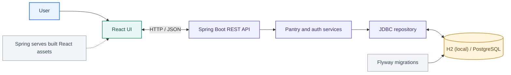
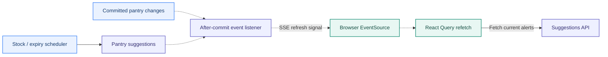
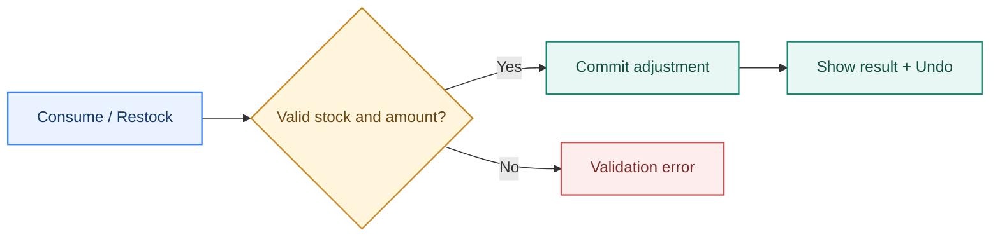
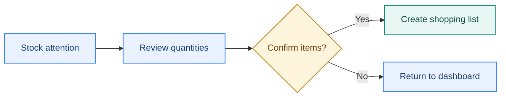

# Architecture

> **Quick read:** PantryPal is a React/TypeScript frontend served by a single Spring Boot application. Spring Boot owns the authenticated REST API, business rules and database transactions. PostgreSQL is used for staging; the default local runtime uses file-backed H2.

**Start here:** [System overview](#application-overview) · [Workflows](#pantry-and-shopping-workflow) · [Transaction guarantees](#adjustment-transaction-and-refresh-sequence) · [Technical reference](ARCHITECTURE-REFERENCE.md)

## Architecture at a glance

| Concern | Implementation | What matters |
| --- | --- | --- |
| Frontend | React, TypeScript, Vite, TanStack Query | Generated API client and cached server state |
| Backend | Java, Spring Boot, Spring Security, JDBC | One service owns validation, authentication and transactions |
| Database | PostgreSQL (staging), H2 (default local) | Flyway versions the schema |
| Identity | Email OTP, Spring Session JDBC | Server-side sessions, account-scoped data and CSRF protection |
| Updates | REST responses + SSE signals | Queries refetch after changes; SSE is best effort |
| Deployment | Spring Boot serves built React assets and `/api` | Local app listens on port 8080; staging runs on Render |
| API contract | OpenAPI + generated TypeScript client | Backend code is implemented separately, not generated |

**Scope boundaries:** This is a single backend service, not a microservice architecture. There is no message broker, durable notification inbox or implemented shared-household authorization. Live retailer pricing and ordering are not implemented.

## Application overview

### Request and storage path

**How to read it:** React sends authenticated API requests; Spring Boot handles application logic and accesses the database through JDBC. Flyway manages schema migrations. Spring also serves the production frontend build.

### Browser interactions

The browser uses React Query to cache API responses. Inventory actions, the dashboard and shopping lists consume the same server-owned state. See the [browser interaction diagram](ARCHITECTURE-REFERENCE.md#browser-interactions).

### Notifications and background checks

| Event | Result |
| --- | --- |
| Inventory transaction commits | Account-scoped after-commit refresh signal |
| Stock or expiry condition changes | Scheduled check may send an alert-change signal |
| Browser receives SSE | React Query invalidates and refetches data |
| SSE unavailable or delivery dropped | HTTP responses and 30-second notification polling still refresh state |
| Session expires or is revoked | Stream is closed; protected requests require valid authentication |

SSE contains event types, **not the underlying alert details**. See [notification edge cases and delivery safeguards](ARCHITECTURE-REFERENCE.md#runtime-modes-and-implementation-details).

## Pantry and shopping workflow

### Inventory adjustment

The server validates changes and commits stock adjustments atomically. The adjustment's idempotency key prevents duplicate application of the same request.

**Undo:** Available only within five minutes and only if no intervening inventory write occurred. See the [Undo eligibility diagram](ARCHITECTURE-REFERENCE.md#undo-eligibility) and [implementation details](ARCHITECTURE-REFERENCE.md#runtime-modes-and-implementation-details).

### Generate a shopping list

Shopping suggestions use **out-of-stock and low-stock** conditions; expiry-only reminders do not automatically generate shopping items. The server revalidates selected items before list creation.

### Complete a purchase

A completed purchase restocks linked inventory rows **once**, in a single transaction. Unlinked manual shopping items do not automatically create inventory records. See the [purchase completion diagram](ARCHITECTURE-REFERENCE.md#complete-a-purchase).

## Adjustment transaction and refresh sequence

| Scenario | Guaranteed behavior |
| --- | --- |
| New valid request | Quantity, revision and history commit together |
| Same request key and same payload | Return current inventory without applying another adjustment |
| Same key with different payload | Reject without changing stock |
| Transaction rollback | Preserve stock and history; no after-commit event |
| Successful Undo | Restore previous quantity only after expiry and revision checks |
| HTTP and SSE arrive in either order | UI must not assume notification ordering |

For request-by-request timing, see the [successful adjustment sequence](ARCHITECTURE-REFERENCE.md#successful-adjustment-and-refresh) and [idempotency/failure diagram](ARCHITECTURE-REFERENCE.md#idempotency-and-failure-handling).

## Runtime modes and implementation details

| Mode | Data and authentication |
| --- | --- |
| Full-stack local | Spring Boot + file-backed H2, real email OTP via configured SMTP / Mailpit |
| PostgreSQL runtime | Spring Boot + PostgreSQL via configured profile and database connection |
| Browser-only `dev:mock` | Local demo adapter and browser storage; not authenticated by Spring |
| Render staging | Deployed integration environment; not a production launch |

**Important engineering constraints:** Email OTP challenges expire and are rate limited; authenticated writes require CSRF protection; session validity is enforced for account-scoped API access. Inventory writes use locking and revision checks. Notification delivery is best effort and must never be treated as a durable event log.

### Explore deeper

| Topic | Authoritative documentation |
| --- | --- |
| Full original technical behavior, design decisions and all nine diagrams | [Architecture technical reference](ARCHITECTURE-REFERENCE.md) |
| Email OTP, sessions and request behavior | [Email OTP flow](EMAIL-OTP-AUTH-FLOW.md) |
| Local setup, profiles, operators and legacy data | [Environment setup](ENVIRONMENT.md) |
| Inventory adjustment checks | [Adjustment workflow tests](ADJUSTMENT-WORKFLOW-TESTS.md) |
| Concurrent adjustment behavior | [Concurrency fix notes](GS-102-CONCURRENT-ADJUSTMENT-FIX.md) |
| Frontend loading and bundle behavior | [Frontend bundle verification](GS-104-FRONTEND-BUNDLE.md) |
| Account deletion and outstanding operational gates | [Data deletion protocol](GS-137-DATA-DELETION.md) |
| Deployment and production readiness | [Production plan](GS-141-PRODUCTION-PLAN.md) |

**Reading order:** Use this page to understand the architecture; open the reference only for implementation specifics, edge cases or troubleshooting.
