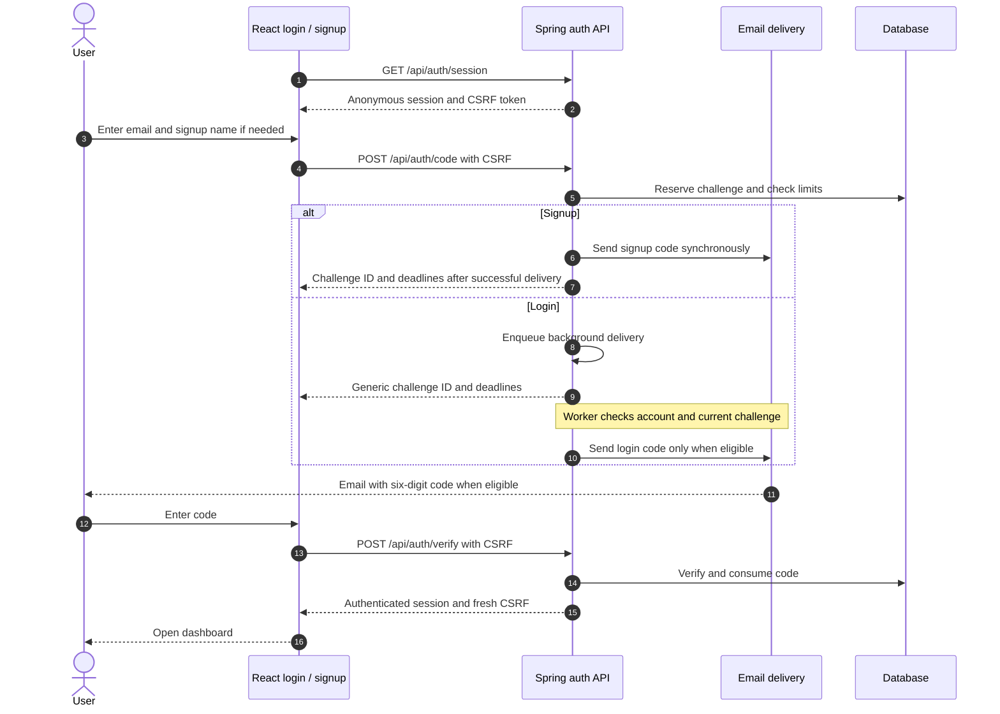

# Email OTP authentication flow

> **Quick read:** Normal Pantry Pal login and signup use server-verified six-digit email codes, an HttpOnly session cookie, and CSRF protection. This guide describes the user-visible flow and key failure cases. The [detailed OTP reference](EMAIL-OTP-AUTH-REFERENCE.md) preserves the complete sequences, transaction safeguards and implementation notes.

**Read next:** [Normal flow](#normal-flow) · [Login versus signup](#login-versus-signup) · [Failures and recovery](#failures-and-recovery) · [Security guarantees](#security-guarantees)

## Normal flow

**Timing note:** Signup sends synchronously and acknowledges delivery outcome. Login acknowledges a queued request and **does not confirm that an account exists or that email was delivered**; its background worker sends only for an eligible existing account. The sequence above describes the typical successful outcome, not a guarantee of email arrival or successful delivery.

## Login versus signup

| Topic | Sign in | Create account |
| --- | --- | --- |
| Email address | Existing account required | Existing account reused or a new account created after valid code |
| Display name | Existing name unchanged | Name required for a new account; existing name not overwritten |
| Code sending | Bounded background queue; generic request response | Synchronous SMTP delivery |
| Unknown email | No email or new account; generic verification failure | Valid verification may create account |
| Delivery error | Request may already have returned generic success | Request reports `503` |
| Account/session result | Database-backed session after verification | Same; rotates session and issues new CSRF token |

**Demo distinction:** `dev:mock` uses browser-local demo auth and code `123456`; it never proves Spring authentication. `VITE_ENABLE_MOBILE_PREVIEW` only enables a UI preview, not SMS sending or mobile account creation.

## Failures and recovery

| Condition | Expected response / next step |
| --- | --- |
| Invalid email, intent or signup name | `400` during code request; correct input |
| Unknown email requests login | Generic challenge response; no actual email and no new account |
| Incorrect code | Generic `400`; failed attempt recorded |
| Attempt cap reached | Signup `429`; login generic `400`; request a fresh code when eligible |
| Code expired | Signup `410`; login generic `400`; request another code |
| Old, used or replaced challenge | Generic `400`; only current unused challenge is eligible |
| Resend during cooldown | `429`; wait until `resendAt` |
| Request or verification quota exceeded | `429` (IP/email limits) |
| Login delivery queue full / stopped | Generic `503`; no request-thread fallback |
| SMTP failure | Signup `503`; login retains earlier generic acknowledgement; retry after cooldown |
| Missing/invalid CSRF on write | `403`; obtain a fresh session token |
| Protected API without session | `401`; sign in |
| Verification succeeded but response lost | Recheck `GET /api/auth/session` to restore authenticated UI |
| Restart with missing stable `AUTH_OTP_SECRET` | Pending OTPs become invalid; existing persisted sessions remain |

The [complete edge-case table](EMAIL-OTP-AUTH-REFERENCE.md#edge-cases-and-observable-outcomes) includes state transitions, logout behavior and retry details.

## Security guarantees

| Mechanism | Implementation |
| --- | --- |
| One-time code | Six digits; five-minute default lifetime; single use |
| Storage | HMAC-SHA-256 digest bound to challenge ID; code not stored in clear text |
| Attempt handling | Default five attempts per challenge; resend cooldown 30 seconds |
| Request quotas | Defaults: 20/IP/hour and 5/email/hour for code requests; 60/IP/hour and 20/email/hour for verification |
| Session | Spring Session JDBC; `PANTRYPAL_SESSION` HttpOnly, SameSite=Lax; seven-day configured lifetime |
| CSRF | `GET /api/auth/session` supplies token; unsafe requests require `X-CSRF-TOKEN` |
| Privacy | Generic login behavior avoids disclosing account existence |
| Concurrency | Challenge locking and one-transaction consumption/account creation; matching challenge IDs prevent stale mail results overwriting resends |

A missing stable OTP secret is unsuitable for production: use a configured secret of at least 32 bytes. Secure cookies and HTTPS are required for deployments; see [environment setup](ENVIRONMENT.md).

## Technical reference

| Need | Reference |
| --- | --- |
| Complete original request and session sequence | [Detailed OTP flow](EMAIL-OTP-AUTH-REFERENCE.md#request-and-session-sequence) |
| SMTP queue, challenge transactions and detailed errors | [Implementation boundaries](EMAIL-OTP-AUTH-REFERENCE.md#data-and-implementation-boundaries) |
| Source implementation | [AuthService](../backend/src/main/java/com/pantrypal/AuthService.java), [AuthController](../backend/src/main/java/com/pantrypal/AuthController.java), [SecurityConfig](../backend/src/main/java/com/pantrypal/SecurityConfig.java) |
| Live configuration and Mailpit | [Environment guide](ENVIRONMENT.md) |
| API contract | [OpenAPI](../lib/api-spec/openapi.yaml) |

**Boundary:** Authentication is account-scoped; household sharing is not implemented. Legacy unowned pantry rows require verified operator intervention, not automatic signup ownership.
