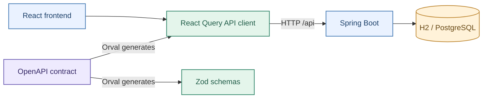
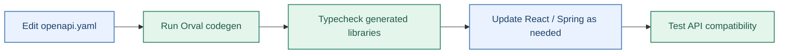

# Shared libraries and API contracts (`lib/`)

> **At a glance:** `lib/` defines Pantry Pal's shared API contract and generates frontend clients and validation schemas. **The running backend is Spring Boot in [`backend/`](../backend/), not `lib/db`.**

**Jump to:** [Architecture](#architecture-at-a-glance) · [Package responsibilities](#package-responsibilities) · [Change an API](#how-to-change-an-api) · [Safe editing rules](#safe-editing-rules)

## Architecture at a glance



- **Source of truth:** [`lib/api-spec/openapi.yaml`](../lib/api-spec/openapi.yaml).
- **Code generation:** [`lib/api-spec/orval.config.ts`](../lib/api-spec/orval.config.ts) produces the generated React Query client and Zod schemas.
- **Runtime:** React calls generated client functions; Spring controllers/services validate and persist data using JDBC and Flyway.
- **Not a runtime dependency:** `lib/db` is a historical Drizzle package; it does not own the active database schema or writes.

## Package responsibilities

| Package | Purpose | Key source or entry point | Edit policy |
| --- | --- | --- | --- |
| [`api-spec`](../lib/api-spec/) | REST contract and Orval configuration | `openapi.yaml`, `orval.config.ts` | Edit contract/config intentionally |
| [`api-client-react`](../lib/api-client-react/) | API functions, TypeScript models and React Query hooks | `src/index.ts`, `src/custom-fetch.ts` | Edit handwritten fetch wrapper; regenerate `src/generated/` |
| [`api-zod`](../lib/api-zod/) | Generated request/response validation schemas | `src/index.ts`, `src/generated/` | Regenerate; never manually edit generated outputs |
| [`db`](../lib/db/) | Historical Drizzle/PostgreSQL implementation | `src/schema/`, `drizzle.config.ts` | Reference only; not active Spring persistence |

### API client and validation details

| Concern | Where | Why it matters |
| --- | --- | --- |
| Public TypeScript exports | `api-client-react/src/index.ts` | Exposes generated hooks/types and fetch configuration |
| HTTP transport | `api-client-react/src/custom-fetch.ts` | Handles base URLs, response handling, API errors, session/CSRF integration and optional token configuration |
| Generated hooks and types | `api-client-react/src/generated/` | Used by React; derived from OpenAPI |
| Generated Zod schemas | `api-zod/src/generated/` | Validations/types derived from the contract |
| Specialized generator rules | `api-spec/orval.config.ts` | Preserves Unicode-aware shopping-list name and unit validation and configured Zod preprocessing |

**Current schema example:** `GrocerySuggestionUrgency` includes `critical`, `low`, `expiring_soon` and `expired`. The active full-stack login uses server-verified **email OTP and database-backed sessions**; browser-only `dev:mock` is separate.

## How to change an API



From the repository root:

```sh
npx pnpm@10.26.1 --filter @workspace/api-spec run codegen
```

The configured `codegen` script runs Orval **and** `pnpm -w run typecheck:libs`. Run relevant backend/frontend tests after changing a contract; generation alone does not implement Spring endpoint behavior.

## Safe editing rules

1. Change [the OpenAPI contract](../lib/api-spec/openapi.yaml) first for API changes, then regenerate generated client and schema files.
2. **Do not hand-edit** `api-client-react/src/generated/` or `api-zod/src/generated/`.
3. Keep browser session cookies HttpOnly; `custom-fetch.ts` coordinates CSRF tokens and unauthorized handling. Optional bearer-token support is not the normal browser login mechanism.
4. Put active validation, transactions and database behavior in Spring controllers/services/repositories, with new [Flyway migrations](../backend/src/main/resources/db/migration/) for schema changes.
5. Do not use the historical `lib/db` Drizzle commands to manage the live Spring schema.
6. Treat `dist/`, `tsconfig.tsbuildinfo`, `node_modules/` and tool caches as generated/local artifacts, not handwritten source.

## Related documentation

| Need | Read |
| --- | --- |
| Overall architecture and key workflows | [Architecture overview](ARCHITECTURE.md) |
| Full technical architecture and flow diagrams | [Architecture reference](ARCHITECTURE-REFERENCE.md) |
| Authentication flow and session boundaries | [Email OTP flow](EMAIL-OTP-AUTH-FLOW.md) |
| Environment configuration and local runtime | [Environment setup](ENVIRONMENT.md) |
| Historical file-by-file inventory and older diagrams | [Detailed lib reference](LIB_FOLDER_REFERENCE.md) |

The historical reference preserves the original guide, including legacy workflow diagrams; consult the **current code** for exact generated-file inventories.
